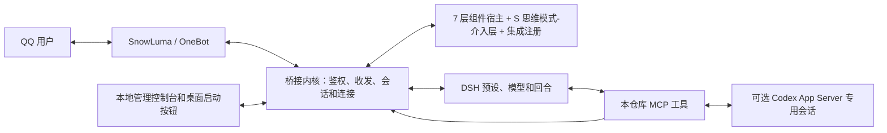

# chat harness:7+2 lays for a AI bot

一个基于 **DeepSeek Harness（DSH）+ SnowLuma / OneBot + 可插拔组件**的聊天机器人框架。提供小鲸鱼人设、QQ 自主收发、会话记忆机制、工具与任务协作、日程提醒、网页变化 AI 整理、运维控制台，以及可选的 Codex Peer。

本仓库发布的是可配置的软件机制。**不附带原作者的记忆、聊天、人物档案、黑话表、知识原稿、课程自动化、监控网址、日程、账号、Cookie 或 Codex 会话。** 使用者配置自己的模型服务、QQ、工具和资料后，可以复现这些功能；模型回答、账号权限、第三方版本和私人资料不同，不保证逐字相同的聊天表现。

基于 [Derpyu520/qq-bridge](https://github.com/Derpyu520/qq-bridge) 扩展，保留其 MIT 许可和署名。DSH、SnowLuma、Codex 分别安装、分别遵循各自的使用条件；本仓库不重新分发这些项目的程序、原生组件或登录状态。

## 7+2 模型

“7”是聊天 agent 的七个工程维度；“+2”是 S · SCHNIE 思维模式-介入层与横切集成面。它们共同形成管理视图，**不是九个必须依次执行的流水线步骤**。现有运行时的层字段是七层加 S，注册中心没有另占一个执行层。

| 维度 | 负责什么 | 仓库中的实现例子 |
|---|---|---|
| C · Context / Memory | 人设、本轮上下文、短中长期记忆、人物信息 | `ctx-chat-style`、`ctx-role-card`、`ctx-memory-*` |
| T · Tooling | MCP、工具定义、参数和结果协议 | QQ MCP、`tool-registry`、`tool-codex-chat` |
| E · Execution | 浏览器、工作目录、执行环境和隔离 | `exec-browser-manager`、`exec-sandbox`、管理员开发模式 |
| L · Lifecycle | 唤醒、回复等待、日程、免打扰、任务恢复 | `life-scheduler`、`life-schedule-reminder`、`life-task-session` |
| O · Observability | 连接状态、日志、成本、诊断和恢复 | `obs-bridge-health`、`obs-cost-policy` |
| V · Verification | 单元测试、协议检查、回归 | `eval-regression`、`scripts/test-*.mjs` |
| G · Governance | QQ 白名单、会话令牌、工具守卫、出站检查 | `gov-policy`、受限 QQ 预设和发送闸门 |
| + S · SCHNIE 思维模式-介入层 | 在适配的对话中提供 SCHNIE 思维引导，并按需介入本地资料 | `schnie-core`；仓库只含机制与公开示例，私人资料由使用者本地配置 |
| + Integration · 横切注册 | 把使用者另装的组件映射到各层，统一配置与启停 | `integration-registry`，不是第九个执行层 |

分层是一种本项目采用的工程组织方法，不把它宣称为学术界统一标准。人格行为属于 C 层；权限检查和真实动作不会只依赖人设文字。

## 技术架构



收到消息后，桥接检查会话白名单、记录本轮消息，由组件决定唤醒和上下文。DSH 使用对应预设生成回复，QQ 动作通过受控 MCP 回到桥接，再交给 OneBot。群聊预设没有管理员本地工具；管理员开发能力默认关闭，需由安装者自己开启。

日程和通知使用持久状态与发送凭据，避免重启后重复投递；已发生的日程默认隐藏，重复日程显示下一期。网页监控先提取正文并计算差异，再批量调用模型生成要点；菜单噪声不提醒，模型不可用时使用规则摘要。所有实际状态都在本机生成。

## 对话与媒体能力

- **未回复补话（L 层）**：私聊等待、私聊抱歉、群聊等待、群聊抱歉四组分别启停、设置激活延迟，并维护各自固定话术表。延迟从合并消息窗口结束后起算，可在控制台的 L 层配置。
- **已读/已回复双时间戳**：模型实际看到消息时记录 `seenAt`，成功回复后记录 `repliedAt`。状态持久化并在重启时恢复；已完整处理的消息不重刷，已看未回和未见消息继续保留待处理。
- **人物档案固定作息块**：档案卡可固定展示本人明确提供的三餐时间与口味、起床/入睡及工作/上课时段。只在本人私聊上下文显示，空字段不占位，群聊不注入该私聊作息。
- **共同兴趣词条（C 层）**：按群聊批次发现可公开查证的兴趣知识，候选需管理员确认后才进入提示词；查询与提交受会话权限和控制台开关约束，研究不把私人资料送去联网搜索。
- **Bilibili 视频工具**：支持匿名只读搜索、视频元数据、公开字幕、受控 FFmpeg 抽帧和视频分析。无需登录；不提供点赞、评论、关注或发送弹幕等写操作。
- **图片工具**：支持图像生成、当前会话图片暂存与查看、受控导入、发送和白名单传图。图片以会话绑定编号引用；本机路径导入限管理员私聊，运行图片与凭据留在本机。

E 层还可接入自行配置的图片生成服务：bot 可把当前会话收到的原图和提示词提交给生图模型，使用图片编号把结果发到原 QQ 群或私聊。每日总额度、分会话额度、输入长度和图片大小均可调整；图片和密钥只留在本机。

## 适用环境与边界

- 主要支持 Windows，Node.js **24+**；安装过程和路径处理提供自动检查。其他系统可复用协议和组件，但 Windows 桌面按钮、QQ 进程启动等路径需要对应平台适配。
- 安装并初始化当前 [DSH 官方项目](https://github.com/deepseek-ai/deepseek-harness)，能够在 DSH 中完成一次普通对话。兼容目标是 Cookie 鉴权、斜杠 RPC 和 `remote.mux` 协议代次；升级后请运行诊断。
- 从 [SnowLuma 官方 Releases](https://github.com/SnowLuma/SnowLuma/releases) 下载完整发行包，自行接入本机 QQ，并在其管理界面开启本地 OneBot HTTP / WebSocket。具体设置以[上游说明](https://github.com/SnowLuma/SnowLuma/blob/main/README.md)为准。
- Codex Peer 是可选项。需要在自己的电脑安装官方 Codex 并完成自己的登录；工具和模型能力取决于自己的账号与运行时。实现基于 [Codex App Server 文档](https://developers.openai.com/codex/app-server)。

## 从零安装

### 1. 准备外部软件

先启动 DSH、完成初始化与模型登录，再打开 QQ 并登录自己的机器人账号。运行 SnowLuma 完整包的启动器，按上游引导接入该 QQ 进程。

在 SnowLuma 中配置：HTTP `127.0.0.1:3000`、WebSocket `127.0.0.1:3001`。若你使用其他端口，在自己的 `config.json` 中同步修改。OneBot 令牌由你在本地配置，不要把它放进公开仓库或聊天记录。

### 2. 下载并安装依赖

```powershell
git clone https://github.com/schrolemons/chat-harness-7-2-lays-for-a-AI-bot.git
Set-Location chat-harness-7-2-lays-for-a-AI-bot
npm ci
npm run configure
```

配置向导只询问自己的管理员 QQ 和 SnowLuma 解压目录。它从无账号模板生成本地 `config.json`，只允许管理员私聊，默认不开群、不允许空白名单放行。需要令牌时，可以在运行向导前设置本机环境变量 `SNOWLUMA_ACCESS_TOKEN`；向导不会打印令牌。

DSH 地址通常是动态端口，启动器会探测已运行的 DSH；也可以在向导中用 `--dsh-url` 指定自己看到的本地地址。

### 3. 安装 DSH 配置和完整 MCP

```powershell
npm run setup -- --profile desktop
npm run doctor
```

Web profile 使用 `--profile web`。非默认 DSH 根目录使用环境变量 `DSH_HOME`。安装器备份现有配置、保留其他插件与会话；重复运行不会重复添加本仓库条目。不要删除 `~/.dsh`、`state/` 或手工复制别人的目录来“修预设”。

安装后会有四个 QQ 预设（`qq-chat`、`qq-chat-v2`、`qq-chat-dev`、`qq-task-worker`），以及后台网页整理用的 `campus-summary`。本地 QQ MCP、只读状态 MCP、搜索 MCP、浏览器 MCP、SCHNIE 思维模式-介入 MCP 与标题栏启动器均有对应源文件。详情见[文件与工具清单](docs/COMPONENTS.md)。

如果 DSH 页面没有立即出现按钮或工具，先刷新页面；必要时保存工作后重开 DSH。DSH 窗口“编辑”右侧的小鲸鱼按钮：红灯可启动，黄灯表示启动中，绿灯表示检查就绪；绿灯时点击打开控制台。

若希望按钮连 QQ 程序也自动拉起，安装时加 `--qq-exe "自己的 QQ.exe 绝对路径"`。否则请先手动启动并登录 QQ。桥接与 SnowLuma 的后续后台启动隐藏命令窗口。

### 4. 启动并试用

```powershell
npm start
```

管理控制台在 `http://127.0.0.1:3100`，本机令牌首次启动时生成在 `state/console-token`；按启动日志给出的方式打开。先测试管理员私聊，再通过控制台逐个添加允许的群或私聊。不要为了省配置开启全开放。

O 层「令牌与花费」支持为每个 QQ 会话单独设置冷漠阈值、花费上限与低频回复间隔，也能设置统一花费上限。统一金额包含 QQ 会话与后台任务的模型调用，可能高于 QQ 会话行的合计。金额按人民币计；同一轮内的计费步骤先合并，再按最后一步时间归入每天北京时间 22:00 开始的周期。`GET /api/tokens/budgets` 读取统计与设置，`POST /api/tokens/budgets` 保存会话设置，`POST /api/tokens/budgets/global` 保存统一上限；这些接口只接受本机控制台管理员令牌。旧累计账本若缺逐次时间戳，页面会提示该周期统计不完整。

保留 `小鲸鱼` 人设卡，已去除私人群聊和成员设定。人格与风格组件支持日常软萌、身份思考和认真解答；表现取决于当前对话，不是固定台词。你可以在本地修改人设。

### 5. 可选：安装 Codex Peer

在官方 Codex 完成自己的登录后运行：

```powershell
npm run setup -- --profile desktop --with-codex
```

自动发现失败时，用 `--codex-path "自己的 codex.exe 绝对路径"`。**无需复制作者文件、保存的 thread ID、登录令牌或浏览器数据。** 详细工作流和给 AI 的配置提示见 [Codex Peer 安装](docs/CODEX_PEER.md)。

### 6. 按需启用网页和个人自动化

网页监控默认关闭、目标为空；在控制台填写自己的“名称 | URL”，再启用对应组件。私有网站需要在独立浏览器配置中自行登录：

```powershell
node scripts/browser-fetch.mjs --url "你自己的目标网址" --visible --website-login
```

完成登录后关闭该窗口。浏览器状态仅存于本机 `state/website-browser/`，不会读取或复制日常浏览器资料。此包不包含任何人的课程脚本或选课接口；需要此类能力时，在本地 `user-scripts/` 编写自己的适配器，并通过组件注册中心接入。

### 7. 可选：图片生成与发群图

在管理控制台的 **E 层 → 图片生成** 选择服务。使用 OpenAI 兼容接口时填写地址（通常以 `/v1` 结尾）、模型、尺寸和质量；使用火山方舟时填写在[开通管理](https://console.volcengine.com/ark/region:cn-beijing/open-management)中有可用额度的 Seedream 模型 ID，保留默认方舟 API 地址并按模型文档设置尺寸。先保存服务与参数，再在当前服务的专用密码框保存 API Key。可从[火山方舟 API Key 页面](https://ark.volcengine.com/region:cn-beijing/apikey)创建方舟 Key。两家密钥分开保存在本地，不进入组件配置或 Git。设置每日额度后检查“已启用”状态；未配置时不会调用外部生图服务。

小鲸鱼可用 `qq_make_meme`（文字或当前会话的消息图片）→ `qq_get_meme_job`（取图片编号和预览）→ `qq_send_image`（发到原会话）完成梗图制作。工具不接受本机文件路径，不能把甲群生成的图发给乙群。每次提交先占每日额度，服务超时不会自动再次付费。OpenAI 兼容接口的参考图走图片编辑接口；方舟的文字与参考图都走[图片生成接口](https://console.volcengine.com/ark/region:cn-beijing/docs/image-generation-api)。第三方兼容服务的实际参数需按其文档核对。

## 发布内容与本地数据

| 随仓库提供 | 仅在使用者本机产生 |
|---|---|
| 桥接与组件代码、MCP、四套 QQ 预设、网页整理预设 | 实际账号、白名单、模型或 OneBot 令牌 |
| 通用小鲸鱼人设、公开参考示例、空配置模板 | 记忆、人物档案、黑话、日程、聊天、日志与发送账本 |
| 通用安装/配置/诊断脚本与回归测试 | Codex 专用会话、viewer 信息与设置、浏览器 Cookie/profile |
| 本地工具代码和安装说明 | 个人监控网址、自定义脚本、私人知识与图片 |

升级时保留自己的 `config.json` 和 `state/`，先备份再更新代码。请勿把运行目录整体压缩发给别人；提交前执行 `npm run privacy:check`，并人工检查 `git diff --cached`。扫描不能代替对新增文件的判断。

## 验证和排障

```powershell
npm test
npm run privacy:check
npm run doctor
node scripts/bridge-health.mjs --json
```

`doctor` 检查文件、配置和 profile 链接，不发送 QQ、不调用模型；运行时健康检查还需要桥接正在运行。预设缺失时重新运行安装器修复目录链接，再核验 DSH 实际清单；不要把 QQ 的受限预设换成含本地工具的默认预设。

安装验证、功能边界和数据保护见 [安装与维护](docs/INSTALLATION.md)、[隐私说明](docs/PRIVACY.md)。
